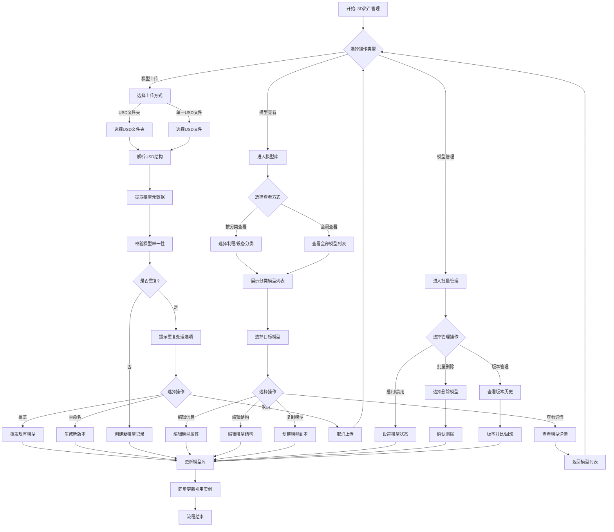
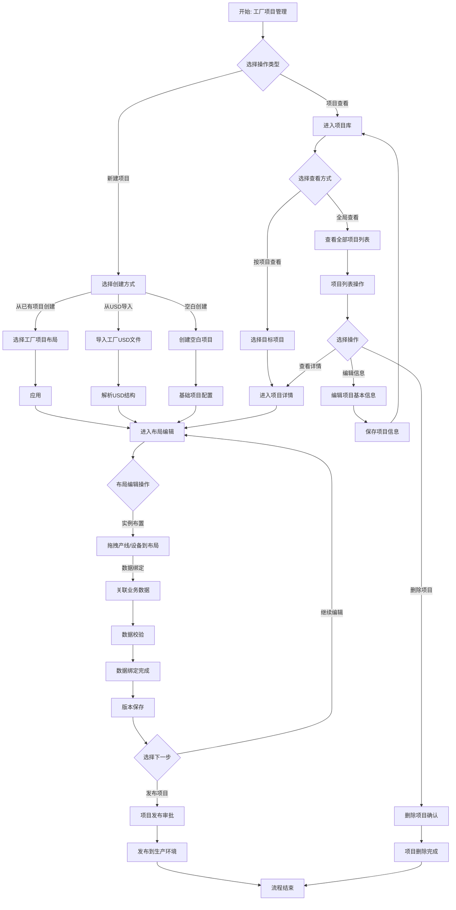
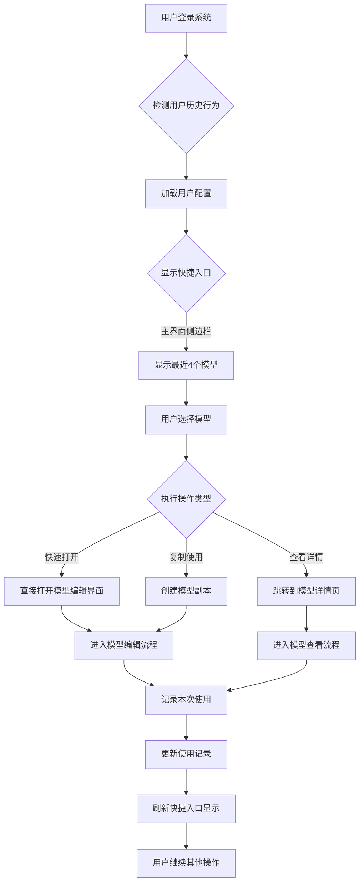

# AI Factory Creator - 产品需求文档 (PRD)

> **文档类型**: 需求分析阶段交付物  
> **版本**: v1.0.6  
> **编制日期**: 2026-10  
> **编制人**: 章亚美（产品）  
> **原编制人**: 原野（产品，已离职）  
> **团队**: 前端 卢棋文、后端 蒋言明、产品 章亚美  

---

## 变更记录 (Changelog)

| 版本 | 日期 | 变更内容 | 影响范围 |
|------|------|---------|---------|
| v1.0.0 | 2026-04-02 | 初始版本创建，编制人 原野 | 全文档 |
| v1.0.1 | 2026-04-19 | 补充单点校验逻辑和整体校验逻辑 | 数据绑定章节 |
| v1.0.2 | 2026-04-19 | 重构业务数据绑定设计：引入多绑定类型、按节点层级定义绑定矩阵、独立状态机 | 数据绑定 + 状态机 |
| v1.0.3 | 2026-04-20 | 补充项目版本管理设计 | 版本管理 |
| v1.0.4 | 2026-04-20 | 功能清单三级展开，模块化编号体系 A1.1 等 | 功能清单 |
| v1.0.5 | 2026-04-20 | B/C/D/E 模块完整功能点定义，总计新增 103 个功能点 | 功能清单 |
| v1.0.6 | 2026-10 | 产品负责人变更：原野（离职）→ 章亚美接替；核心功能清单移至[开发任务清单]，PRD 保留摘要引用 | 编制人、功能清单章节 |


---

## 术语定义

| 术语 | 定义 |
|------|------|
| AI Factory Creator | 基于 NVIDIA Omniverse USD Composer 构建的工厂 3D 数字孪生布局设计工具 |
| USD | Universal Scene Description，通用场景描述格式，3D 场景数据交换标准 |
| 3D 资产模型 | 设备或产线的 3D 数字模型，包括几何、材质、属性等信息 |
| 资产实例 | 在工厂项目中具体放置的资产模型实例，具有位置、旋转、缩放等空间属性 |
| IE 工程师 | 工业工程师，负责工厂布局设计和优化 |
| 基础数据平台 | 整合 ERP/MES/WMS 等系统数据的统一数据服务平台 |

---

## 一、项目概述

### 1.1 背景 — 为什么要做

- 公司为 SMT 制造业，年产值千亿，产品每月更新换代
- 每次产品更新需重新调整产线和设备布局，IE 工程师手动设计耗时 **2-3 天**
- 现有 ERP、WMS、MES 系统各自独立，数据不互通
- 决策缺乏数据支持，依赖 Excel 表格和经验判断

**四大核心痛点**：
1. **布局设计效率低** — 手工设计无法快速响应产品迭代
2. **决策缺乏数据** — 缺乏实时业务数据关联，导致物理调整错误
3. **系统集成差** — 业务数据与 3D 场景脱节，无法实现真正数字孪生
4. **知识沉淀难** — 布局设计经验依赖个人，难以复用

### 1.2 产品目标

| 维度 | 目标 | 指标 |
|------|------|------|
| 布局设计效率 | 2-3 天 → 2-3 小时 | 效率提升 ≥ 80% |
| 设计错误率 | 减少物理返工 | 降低 ≥ 50% |
| 系统可用性 | 稳定运行 | ≥ 99.5% |
| 场景加载 | 1000 设备模型 | ≤ 10 秒 |
| 操作响应 | 核心操作 | P95 ≤ 200ms |

### 1.3 目标用户

| 角色 | 职责 | 占比 |
|------|------|:---:|
| **IE 工程师** | 工厂布局设计、产线平衡、效率优化 | 60% |
| **工厂规划师** | 布局方案评审与决策 | 15% |
| **3D 模型工程师** | 模型创建、上传、维护 | 10% |
| **系统管理员** | 用户管理、权限配置、系统维护 | 10% |
| **项目管理员** | 项目创建、版本控制、协作管理 | 5% |

### 1.4 范围边界

**Phase 1 — P0 核心（6 个月，已完成 ✅）**：
- 基于 Omniverse USD Composer 的 3D 引擎封装
- 设备 3D 模型库管理（上传/浏览/详情）
- 拖拽式工厂布局编辑（选择/移动/旋转/缩放）
- 多视角查看（顶视/前视/3D 视图）
- 工厂项目创建、保存、版本管理
- 业务数据绑定配置与校验

**Phase 2 — P1 高级（规划中）**：
- 高级编辑工具（对齐/分布/成组）
- 产线模板库、设备组合模板
- 布局图、BOM 清单导出
- 测量与标注工具

**Phase 3 — P2 扩展（远期）**：
- 与 MES/ERP/WMS 标准数据接口
- 多人协同编辑
- 大规模场景 LOD 优化
- 插件架构

**明确不在范围内**：物理仿真引擎、实时监控控制、移动端应用、AI 自动布局、专业 CAD 设计

---

## 二、功能结构总览

```
AI Factory Creator
├── A. 3D资产模型管理模块
│   ├── A1. 模型查看与检索（P0）
│   ├── A2. 模型上传与导入（P0）
│   ├── A3. 模型编辑与更新（P2）
│   ├── A4. 模型版本管理（P2）
│   ├── A5. 模型生命周期管理（P2）
│   └── A6. 模型关联管理（P2）
├── B. 工厂项目管理模块
│   ├── B1. 项目创建与导入（P0）
│   ├── B2. 布局设计与编辑（P2）
│   ├── B3. 项目版本管理（P0）
│   ├── B4. 项目协作（P2）
│   ├── B5. 项目导出与报告（P2）
│   ├── B6. 项目操作日志（P2）
│   └── B7. 业务数据绑定子模块
│       ├── B7.1 业务数据源连接与定时同步（P1）
│       ├── B7.2 数据绑定配置（P0）
│       └── B7.3 数据校验与冲突解决（P0）
├── C. 3D可视化编辑模块
│   ├── C1. 基础编辑工具（P0）
│   ├── C2. 高级编辑工具（P1）
│   ├── C3. 视图与导航（P0）
│   ├── C4. 测量与标注工具（P1）
│   └── C5. 模板与批量操作（P1）
├── D. 集成配置模块（P2）
│   ├── D1. 基础数据平台连接配置
│   ├── D2. 外部系统数据源管理
│   ├── D3. 数据同步策略配置
│   ├── D4. 接口监控与日志
│   └── D5. 数据转换与适配
└── E. 系统管理模块
    ├── E1. 用户与权限管理（P1）
    ├── E2. 系统配置管理（P1）
    ├── E3. 操作日志与审计（P2）
    ├── E4. 性能监控与优化（P2）
    └── E5. 帮助与文档（P2）
```

---

## 三、业务流程

### 3.1 3D 资产模型管理流程



**关键节点**：

| 节点 | 名称 | 角色 | 校验规则 | 异常处理 |
|:---:|------|------|---------|---------|
| N1 | 模型查看与检索 | IE工程师 | 关键词 ≥ 2 字符 | 无结果提示、搜索超时重试 |
| N2 | USD模型上传 | 3D模型工程师 | 文件 ≤ 500MB、格式 USD、名称唯一 | 格式不支持提示转换、文件损坏提示重传 |
| N3 | 模型编辑与更新 | 3D模型工程师 | 关联项目时提示影响确认 | 更新冲突提示合并或覆盖 |
| N4 | 模型启用/禁用 | 3D模型工程师 | 禁用前检查引用关系 | 被引用时提示无法禁用详情 |
| N5 | 模型删除 | 3D模型工程师 | 必须已禁用、无项目引用 | 引用残留提示手动清理 |

### 3.2 工厂项目管理与布局编辑流程



**关键节点**：

| 节点 | 名称 | 角色 | 校验规则 | 异常处理 |
|:---:|------|------|---------|---------|
| P1 | 项目创建与初始化 | IE工程师 | 名称组织内唯一、权限验证 | 名称重复提示修改、权限不足提示申请 |
| P2 | 拖拽式布局编辑 | IE工程师 | 设备碰撞检测、安全间距合规 | 冲突提示调整、保存失败提示重试 |
| P3 | 业务数据绑定 | IE工程师/系统集成师 | 接口连通性、数据格式、映射完整性 | 连接失败提示检查、映射缺失提示补充 |
| P5 | 项目版本管理 | 所有成员 | 备注必填、重大变更需审批 | 版本冲突提示合并 |

### 3.3 3D 资产快捷入口流程



### 3.4 流程设计原则

**反向闭环**：工厂项目中上传的 USD 文件可反向存储至 3D 资产库，建立模型与实例的引用关系。

```
3D资产库 ──正向（模型实例化）──→ 工厂项目
    ↑                              │
    └──反向（实例模型化）──────────┘
```

**属性继承层级**：实例属性 > 模型默认属性 > 模型基础属性

**状态流转**：草稿 → 审核 → 执行 → 完成（标准），驳回/取消/关闭/挂起（异常）

---

## 四、功能清单摘要

V1.0.0 初版交付 **22 个 P0 功能点 + 3 个 P1 功能点**，覆盖"模型上传 → 项目创建 → 布局编辑 → 数据绑定"核心闭环。

| 模块 | P0 已完成 | P1 已完成 | 特点 |
|------|:---:|:---:|------|
| A. 3D资产模型管理 | 5（上传/浏览/详情/校验/元数据） | 1（智能搜索） | 模型库集中化管理 |
| B. 工厂项目管理 | 12（项目CRUD/拖拽编辑/撤销重做/版本管理/数据绑定全链路） | 0 | 项目闭环 + 数字孪生核心 |
| C. 3D可视化编辑 | 5（选择/移动/旋转/缩放/多视图） | 0 | 基础交互完备 |
| E. 系统管理 | 0 | 2（用户管理/系统配置） | 管理员基本就绪 |

> **完整功能清单（含 P0/P1/P2 逐项、负责人、状态）见**：[开发任务清单](../设计开发测试/开发任务清单.md)

**P1/P2 后续关键待办**：

| 编号 | 功能点 | 优先级 | 计划版本 |
|------|--------|:---:|:---:|
| C2.1 | 高级编辑工具（对齐/分布/成组） | P1 | V1.1 |
| B5.1 | 布局图与 BOM 导出 | P1 | V1.1 |
| C4.1 | 测量与标注工具 | P1 | V1.1 |
| C5.1 | 产线模板库 | P1 | V1.1 |
| B7.1 | 基础数据平台连接与定时同步 | P1 | V1.1 |
| D1~D5 | 集成配置（全量） | P2 | V1.2 |
| B4.1 | 多人协同编辑 | P2 | V1.3 |

---

## 五、业务数据绑定设计

数字孪生的绑定与设置不是单一维度：
- **绑定**：基础数据、台账（Ledger）、IoT
- **设置**：事件（Events）、状态监控（Monitor）、指标 KPI（Metrics）

不同层级节点所需绑定类型不同，各节点独立维护状态。

### 5.1 绑定类型矩阵

| 节点层级 | 基础数据 | 台账 | IoT | Events | Monitor | Metrics |
|---------|:---:|:---:|:---:|:---:|:---:|:---:|
| **工厂** | ✅ 必需 | ❌ | ❌ | ❌ | ❌ | ✅ 可选 |
| **制程** | ❌ 不参与绑定 | ❌ | ❌ | ❌ | ❌ | ❌ |
| **产线** | ✅ 必需 | ❌ | ❌ | ✅ 可选 | ✅ 可选 | ✅ 可选 |
| **设备** | ✅（即台账） | ✅ 必需 | ✅ 可选 | ✅ 可选 | ✅ 可选 | ✅ 可选 |

### 5.2 绑定前置依赖

基础绑定（基础数据/台账）是其他所有绑定类型的前置条件。可选类型之间相互独立，无顺序依赖。

```
工厂：  基础数据 ──→ Metrics（可选）

产线：  基础数据 ──→ Events（可选）
                ├──→ Monitor（可选）
                └──→ Metrics（可选）

设备：  台账 ──────→ IoT（若有数采数据，台账完成绑定后自动绑定）
            ├──────→ Events（可选）
            ├──────→ Monitor（可选）
            └──────→ Metrics（可选）
```

### 5.3 节点绑定状态机

配置内容为结构化表单，可分步保存，存在"部分完成"状态。

```
未配置 ──→ 部分配置 ──→ 已绑定
   ↑          ↑        │ 异步检测
（新节点/解绑） （修改后未完成）  ↓
                       绑定异常 ──→ 已绑定（修复后重新同步）
```

| 状态 | 说明 | 触发条件 | UI 显示 |
|------|------|---------|:---:|
| 未配置 | 初始状态，无任何数据保存 | 节点新建/未绑定/解绑 | 灰色 |
| 部分配置 | 已绑定但必填字段不完整 | 必填字段未全填 | 黄色 |
| 已绑定 | 必填字段完整，校验通过 | 单点校验全部通过 | 绿色 |
| 绑定异常 | 数据源变更/连接中断 | 异步检测到异常 | 红色 |

### 5.4 校验逻辑

**单点校验**（点击「绑定」时触发）：

| 配置类型 | 核心校验内容 | 错误处理 |
|---------|------------|---------|
| 基础数据/台账 | 字段类型合规、必填完整、关联父级匹配、子节点数量一致 | 不合规字段不绑定但其他保存、父级不匹配阻止绑定 |
| IoT | 同"基础数据"校验 + 手动连接测试 | 无法联通时 URL 后备注"无法联通" |
| Events | 触发条件表达式合法、名称唯一、严重级别合法枚举值 | 表达式错误高亮，不可保存 |
| Monitor | 监控参数存在、阈值合理（min < max） | 引用不存在警告，阈值无效阻止保存 |
| Metrics | 公式引用字段已配置、表达式合法、名称唯一 | 公式错误提示具体位置，不可保存 |

**整体校验**（点击「Validate」触发）：对项目级所有节点进行绑定完整性和数据一致性全面校验，生成校验报告。校验维度包括绑定完整性、数量匹配（3D 实例 vs 业务系统记录）、内容一致性。

### 5.5 同步场景

当前仅实现**场景 3**：业务系统已有数据，将现有数据关联 3D 资产实例（映射绑定）。

| 绑定类型 | 主要数据来源（经基础数据平台） |
|---------|--------------------------|
| 基础数据 | ERP 设备/产线/工厂主数据 |
| 台账 | ERP 设备台账、MES 工艺参数 |
| IoT | IoT 平台采集点位配置及实时数据 |
| Events | MES 事件规则、IoT 平台告警规则 |
| Monitor | MES 设备状态、IoT 平台监控数据 |
| Metrics | MES 生产数据、IoT 采集数据（KPI 计算） |

---

## 六、项目版本管理设计

### 6.1 版本化数据范围

| 数据类别 | 是否必选 | 存储方式 |
|---------|:---:|------|
| 布局数据（位置/旋转/缩放/层级） | 是 | 增量存储 |
| 业务数据绑定配置 | 是 | JSON 全量 |
| 绑定状态快照 | 是 | 与配置一并存储 |
| 项目元数据 | 是 | 全量 |

> 绑定的业务数据**值不存储**在版本中，仅保存引用标识符（如设备编码）。实际数据始终从基础数据平台实时获取。

### 6.2 版本号规范

语义化版本 `主版本.次版本.修订号`（如 `1.2.3`）：

| 版本级 | 触发条件 |
|--------|------|
| 主版本 | 重大架构或业务变更 |
| 次版本 | 功能增加或较大修改 |
| 修订号 | Bug 修复或小调整 |

- 手动创建时用户选择升级类型
- 自动保存仅增加修订号
- 发布版本自动升级次版本

### 6.3 差异比较与回滚

- **3D 布局差异**：并排显示，高亮新增（绿）/删除（红）/移动（蓝）
- **绑定配置差异**：表格对比绑定类型、对象、内容变化
- **回滚**：支持全项目回滚 + 选择性回滚（仅布局 / 仅特定绑定类型）
- **回滚前影响分析**：列出受影响实例和绑定关系，提示风险

### 6.4 性能指标

| 操作 | 1000 实例场景目标 |
|------|:---:|
| 版本创建 | ≤ 5 秒 |
| 版本加载 | ≤ 10 秒 |
| 差异计算 | ≤ 3 秒 |

---

## 七、关键业务规则

以下为核心规则摘要，完整规则见[规则总表]。

| 规则域 | 规则名称 | 核心逻辑 |
|--------|---------|---------|
| **模型管理** | 模型唯一性 | 同一分类下编码必须唯一 |
| **模型管理** | 模型引用检查 | 有项目引用时阻止删除/禁用 |
| **数据绑定** | 基础绑定完整性 | 基础数据/台账必须完成才可配置其他绑定类型 |
| **数据绑定** | 绑定类型层级限制 | 工厂仅限 BASIC_DATA/METRICS；制程不允许绑定 |
| **数据绑定** | 状态异常检测 | 连续 3 次同步失败 →「绑定异常」→ 发送告警 |
| **数据绑定** | 部分配置保存 | 必填不完整允许保存为「部分配置」状态 |
| **实例管理** | 实例属性继承 | 实例继承模型默认属性，可覆盖但不可删除 |
| **系统性能** | 场景复杂度 | 单项目最大 5000 实例，建议 ≤ 3000 |
| **系统性能** | 模型文件限制 | 单个模型 ≤ 2GB，总库 ≤ 1TB |
| **权限安全** | 操作审计 | 所有关键操作记录审计日志，保留 180 天 |
| **权限安全** | 会话超时 | 8 小时超时，30 分钟无操作需重新验证 |

---

## 八、角色与权限

### 8.1 功能级权限矩阵（核心操作）

| 功能/操作 | IE工程师 | 工厂规划师 | 3D模型工程师 | 系统管理员 | 项目管理员 |
|-----------|:---:|:---:|:---:|:---:|:---:|
| 浏览模型库 | ✓ | ✓ | ✓ | ✓ | ✓ |
| 上传新模型 | ✗ | ✗ | ✓ | ✗ | ✗ |
| 编辑模型属性 | ✗ | ✗ | ✓ | ✗ | ✗ |
| 删除模型 | ✗ | ✗ | ✓ | ✗ | ✗ |
| 创建新项目 | ✓ | ✓ | ✗ | ✗ | ✓ |
| 打开项目编辑 | 自己的 | 部门的 | ✗ | 全部 | 管理的 |
| 添加/编辑资产实例 | ✓ | ✓ | ✗ | ✗ | ✗ |
| 配置数据绑定 | ✓ | ✓ | ✗ | ✗ | ✗ |
| 用户管理 | ✗ | ✗ | ✗ | ✓ | ✗ |
| 系统配置 | ✗ | ✗ | ✗ | ✓ | ✗ |

### 8.2 数据范围控制

- 按组织架构：用户只能访问自己所在工厂/车间/部门的数据
- 按项目归属：用户只能访问自己创建或参与的项目
- 按角色层级：高层级角色可查看下级角色数据
- 按数据分类：敏感数据（如成本）需额外权限

---

## 九、关键页面清单

| 页面 | 菜单路径 | 主要用户 | 目的 |
|------|---------|------|------|
| 模型库首页 | 模型库 / 首页 | IE工程师、3D模型工程师 | 浏览和搜索设备模型 |
| 模型详情页 | 模型库 / {模型名称} | IE工程师、3D模型工程师 | 查看模型详情和版本历史 |
| 模型上传页 | 模型库 / 上传 | 3D模型工程师 | 上传新模型 |
| 项目仪表板 | 项目 / 仪表板 | IE工程师、项目管理员 | 管理所有工厂项目 |
| 3D 编辑工作台 | 项目 / {项目名} / 编辑 | IE工程师、工厂规划师 | 编辑 3D 工厂布局 |
| 数据绑定配置页 | 项目 / {项目名} / 数据绑定 | IE工程师、系统集成师 | 配置业务数据绑定 |
| 项目版本历史页 | 项目 / {项目名} / 版本 | IE工程师、项目管理员 | 查看和管理项目版本 |
| 系统管理后台 | 系统管理 / 仪表板 | 系统管理员 | 用户管理、系统配置 |

---

## 十、集成边界

| 系统 | 职责边界 | 交互方式 |
|------|---------|---------|
| **基础数据平台** | 整合各业务系统数据，提供统一数据服务 | API 实时/定时同步 |
| **ERP** | 设备主数据、物料数据 | 通过基础数据平台同步 |
| **MES** | 设备实时状态、生产执行数据 | 通过基础数据平台同步 |
| **WMS** | 物料库存、库位信息 | 通过基础数据平台同步 |
| **Omniverse** | 3D 渲染引擎、基础编辑工具 | SDK 集成 |

Creator 仅与基础数据平台对接，不直接连接各业务系统。

---

## 十一、非功能性需求

| 维度 | 指标 | 目标值 |
|------|------|:---:|
| 响应时间 | 页面加载 / 操作响应 | ≤ 3 秒 / ≤ 200ms (P95) |
| 并发 | 同时在线 / 同时编辑 | 50 / 20 用户 |
| 存储 | 模型总数 / 单模型上限 | 10,000 个 / 2GB |
| 可用性 | 系统整体 / 核心功能 | ≥ 99.5% / ≥ 99.9% |
| 恢复 | RTO / RPO | ≤ 4 小时 / ≤ 1 小时 |
| 安全 | 传输加密 / 存储加密 | TLS 1.3 / AES-256 |
| 审计 | 日志保留 | ≥ 180 天 |

---

## 十二、风险与依赖

### 12.1 外部依赖

| 依赖项 | 提供方 | 风险 | 兜底方案 |
|--------|--------|------|---------|
| Omniverse 平台稳定性 | NVIDIA | API 不兼容 | 锁定特定版本 |
| ERP 系统接口 | 内部 IT | 接口延迟 | 模拟数据先行开发 |
| 3D 模型库 | 建模团队 | 数量不足 | 采购商用模型库补充 |
| 用户硬件 | 用户部门 | 不达标 | 云渲染方案备选 |

### 12.2 核心风险

| 风险 | 可能性 | 应对策略 |
|------|:---:|---------|
| 3D 性能不达标 | 高 | 性能优化专项、LOD 技术 |
| 系统集成复杂度 | 高 | 分阶段集成、先核心后扩展 |
| 用户接受度低 | 中 | 培训体系、持续收集反馈优化 |
| 范围蔓延 | 中 | 严格变更流程、优先级管理 |

---

## 十三、开放决策点

| 编号 | 决策点 | 建议方案 | 状态 |
|:---:|------|---------|:---:|
| OP-001 | ERP/MES/WMS 数据同步策略 | 混合：关键实时同步，物料定时同步，布局手动同步 | 待决策 |
| OP-002 | 模型库初始数据来源 | 组合：核心设备内部建模，通用设备采购，专用设备供应商提供 | 待决策 |
| OP-003 | 多人协作冲突解决策略 | Phase 1 乐观锁，Phase 3 分支合并 | 待决策 |

---

## 交付物关联索引

| 交付物 | 路径 | 覆盖内容 |
|--------|------|------|
| 可行性研究报告 | [01 可行性研究报告](../项目立项/01%20可行性研究报告.md) | 技术/经济/组织可行性分析 |
| 项目章程 | [02 项目章程](../项目立项/02%20项目章程.md) | 目标/范围/里程碑/组织 |
| 迭代计划 | [迭代计划](迭代计划.md) | Sprint 0~4 时间线与范围 |
| 开发任务清单 | [开发任务清单](../设计开发测试/开发任务清单.md) | P0/P1 完整任务列表与状态 |
| 工时预估表 | [工时预估表](../设计开发测试/工时预估表.md) | 10 人月明细 |
| 自动化测试报告 | [自动化测试报告](../设计开发测试/自动化测试报告.md) | V1.0.0 测试与缺陷统计 |
| Release Notes | [版本Release Notes](../软件交付销售/版本Release%20Notes.md) | V1.0.0~V1.0.2 Changelog |
| 操作手册 | [产品交付操作手册](../软件交付销售/产品交付操作手册.md) | 角色化操作指南 |
| 迭代复盘 | [迭代成果总结报告](../经验总结/迭代成果总结报告与数据复盘表.md) | 工时/功能/质量/效率复盘 |

---

*文档结束*